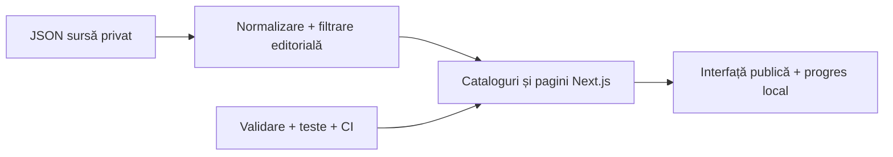

# ROMÂNIA 2030

Portal civic independent, în română, pentru explorarea unui blueprint de politici publice 2026–2030.

## Pornire locală

Necesită Node.js 20.9 sau mai nou și npm.

```powershell
npm install
npm run dev
```

Deschide `http://localhost:3000`. Comenzi de verificare:

```powershell
npm run content:normalize
npm run content:validate
npm run content:audit
npm test
npm run lint
npm run typecheck
npm run build
```

## Structură



Fișierul-sursă brut rămâne local în `content/source/` și nu este inclus în repository-ul public. Repository-ul conține doar setul editorial normalizat din `content/normalized/public-content.json`, folosit de site și filtrat pentru publicare.

## Ce include

Catalog filtrabil și căutare tolerantă la diacritice; pagini pentru reforme și detalii, schițe legislative, inventar constituțional, calendar, surse, secțiuni tematice și informații editoriale. Fiecare reformă are o ilustrație proprie. Panoul administrativ păstrează stările și marcarea finalizării doar în browserul curent. Nu există autentificare, bază de date, sincronizare, formular de contact, analytics sau endpoint de editare; panoul local nu protejează o instalare publică.

## Statut editorial

Acesta este un draft de consultare. Propunerile nu sunt legi adoptate, calendarul nu este raport de execuție, iar costurile neprecizate apar ca „Neestimat”. O fișă despre un caz penal real și două referințe media sunt reținute până la verificare juridică și editorială.

## Publicare

Repository-ul GitHub și proiectul Vercel sunt configurate; există deja un deployment public pe URL-ul Vercel, dar nu este aprobată o lansare finală și nu există domeniu propriu. Identitatea juridică a operatorului și datele publice de contact sunt încă de completat. Proiectul rămâne `noindex` până la revizuirea editorială și juridică. Consultă [runbook-ul](docs/PUBLICATION_RUNBOOK.md) și [revizia de securitate](docs/SECURITY_REVIEW.md).

## Licență și referință tehnică

Codul aplicației este MIT; datele blueprintului și textele editoriale sunt în afara licenței codului. Election Lab a fost consultat ca referință tehnică; codul demo și datele electorale nu au fost copiate.
